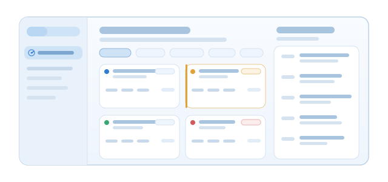

# Mission Control

A DeepSeek Harness plugin that adds a **Mission Control** entry to the left
sidebar and the dashboard it opens: one card per session, the state it is in,
how long its current task has been running, what its log says it has done, and
which sessions are waiting for you.



Everything comes from facts the Harness already owns. The Host half folds each
session's committed event log into counters; the Browser half reads the Session
Controller's live catalog and status. The plugin never polls an agent, never
guesses a percentage, and never sends a prompt.

## Features

- **One card per session** in the left sidebar's `Mission Control` panel, sorted
  and filtered without leaving the dashboard.
- **Session identity**: durable title (falling back to the working-directory
  name), selected model and provider, and the agent preset.
- **Execution state**: working, waiting for you, completed, error, or idle, from
  the Session Controller's own `running`, `pendingInteraction`, and the last
  `turn/end` reason.
- **Independent per-task timer**: the open turn is timed against a local clock;
  finished tasks show their measured duration.
- **Work counters**: tool calls, failed tool calls, completed turns, pending
  todos, queued messages, and token counts.
- **Estimated cost** per session when you enter token prices (Harness publishes
  token counts, not prices; nothing is invented).
- **Recent activity feed** built from the last events of every session.
- **Needs-intervention alert** naming the sessions waiting for an approval, an
  answer, or a plan review.
- **Filters and sorting**: by state, by runtime, by pending tasks, by recent
  activity, or by name.
- **Click to navigate**: a card (or a feed row) opens that session in the
  Conversation.
- **English / Spanish toggle** at the top of the panel, with the choice
  remembered. The plugin metadata and this README are in English.
- **Automatic updates**: the panel re-renders when the framework's own session
  sources change — no polling, no prompts.

## How it works

The dashboard has two halves:

| Piece | File | Role |
|---|---|---|
| Host projection unit | [`projection-fold.js`](projection-fold.js) | A pure, synchronous fold over committed session events: `tool/call`, failed `tool/result`, `turn/end` with its recorded reason, `turn/start`→`turn/end` timings, the failed turn's own `LlmFailure`, and the last eight activity entries |
| Host entry | [`index.js`](index.js) | Registers the unit as the `missionControl` projection key in `ctx.sessionProjections` (`wire.summary: false`, so session-list payloads keep their documented summary keys) |
| Browser panel | [`client.js`](client.js) | Registers the `sidebar.panellist` row and the `main` panel keyed `mission-control`, reads `useSessions()` and `useSessionStatus()`, and opens sessions with `ctx.uiWorkspace.openSession()` |

Data sources, all official:

| On the card | Source |
|---|---|
| Session title | `title` projection, else the display title the catalog derives from the working directory |
| Selected model | `modelSelection` projection (`next`, else `lastUsed`) |
| Execution state | catalog/`SessionStatus` `running`, `pendingInteraction`, and the last `turn/end` reason |
| Per-task timer | `turn/start` → `turn/end` event times, plus a local clock for the open turn |
| Tool calls / tasks | `tool/call` events and `turn/end` records with reason `completed` |
| Pending | pending todos + queued inbox messages + a pending interaction |
| Tokens | `tokenUsage` projection |
| Estimated cost | those tokens × the prices you enter in Display settings |
| Recent activity | the per-session entries kept by the fold |

The Host half adds no Remote method and no HTTP route: the counters ride the
Session Controller's existing control stream, which already carries every live
session's projection set to the page.

## Requirements

- DeepSeek Harness `>= 0.2.0` (developed and verified on `0.2.2-rc.5`, Desktop).
- The Web Client, where the panel lives.

## Install

**Plugin Manager → Plugins → Add plugin**, then pick this directory (a local
directory install links the checkout) or the package name once published.

Or from the command line, with the bundle directory as the source:

```sh
dsh plugin install /path/to/dsh-mission-control
```

After installing, open **Mission Control** in the left sidebar.

## Usage

- **Cards** summarize one session each. The dot and label give the state; the
  timer says how long the current task has been running (`Running · 3m 12s`) or
  how long the last one took (`Last task · 45s`).
- **Click a card** to open that session in the Conversation. Subagent cards open
  their parent's conversation at the child's address.
- **Filter chips** show a count per state; **Sort** switches between runtime,
  pending tasks, recent activity, and name.
- **The alert** at the top names the sessions that need you, and **Show them**
  applies the waiting filter.
- **Display settings** (gear): compact cards, token prices, and reset.
- **EN / ES** switches the panel language; the choice is stored with the other
  display settings.

### Cost estimates

Harness reports token counts, not money. The cost chip appears only after you
enter prices in *Display settings* (`USD per 1M tokens`, optionally split into
input, output, cache read, and cache write), and it is labeled as an estimate.
With no prices, no cost is shown.

### Preferences and persistence

Filter, sort, compact cards, prices, and panel language are stored in the
browser under `dsh.mission-control.prefs.v1` — the same localStorage mechanism
the shipped terminal and shortcut plugins use — so they survive reloads and app
restarts on the same origin. The settings panel restores defaults on demand.

## Privacy and side effects

- The plugin reads the session registry, projections, and event log. It does not
  write session events, add a session event type, or open network connections.
- No prompt, message, or follow-up is ever sent to an agent by the dashboard.
- Turning the plugin off removes the sidebar entry, the panel, and the counters.

## Limitations

- Counters cover sessions that are **live in the Host**: they arrive with the
  control stream's projection baseline. A session that is only on disk still
  shows its durable title, model, and tokens (list summary hints) with `—`
  counters until it is opened or resumed.
- A live agent failure outside a turn (`api-session/error`) is not part of the
  projection; cards report turn outcomes and tool failures.
- The dashboard shows recorded facts only: there is no progress percentage and
  no synthesized agent activity.
- Panel preferences are per browser origin, not per session.

## Development

```sh
node --test test/fold.test.mjs          # fold semantics and publishing shape
node --test test/client.test.mjs        # panel render, derivation, filters, language, preferences
node test/replay.mjs [sessionsDir] [n]  # replay real session logs and compare counters
```

The client test loads `client.js` with a minimal React, renders the registered
panel with fake session inputs, and checks the real derivation and dictionaries.
`replay.mjs` decodes on-disk session logs (one zstd frame per record) and
compares the fold against an independent count over the same decoded events.

## Author

**Alejavi Rivera**

- YouTube channel: <https://www.youtube.com/@alejavirivera>
- Video where the prompt is shared: <https://www.youtube.com/watch?v=_fgcYcSA7oo&t=5s>

## License

MIT — see [LICENSE](LICENSE).
